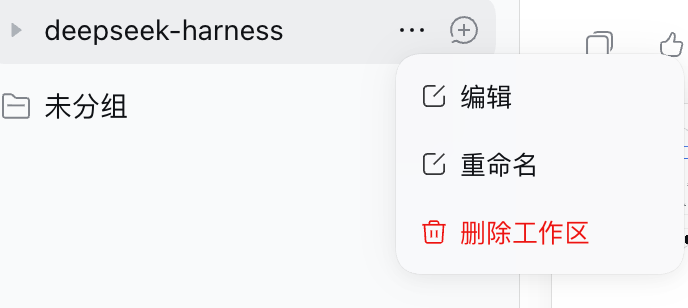
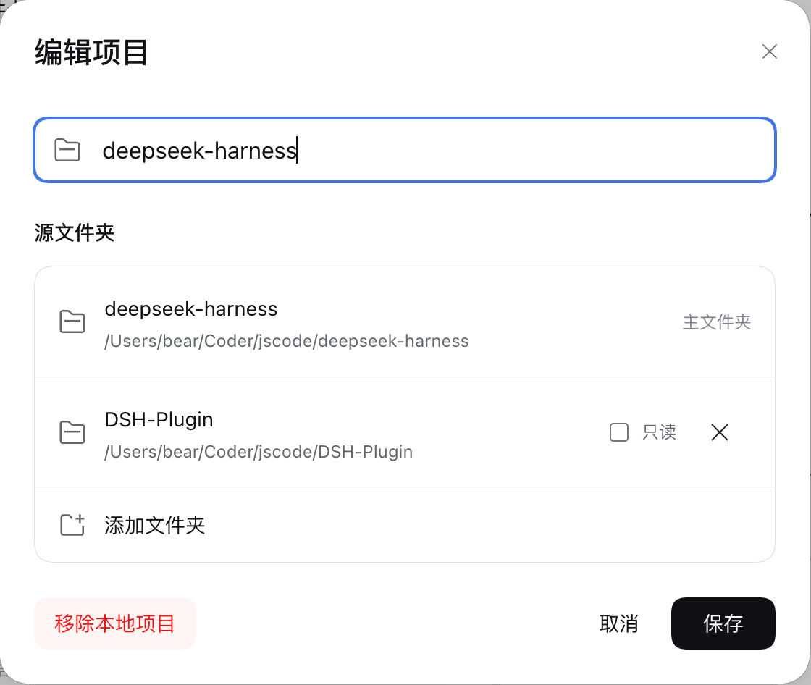

<p align="center">
  
</p>

<h1 align="center">dsh-plugin-addir</h1>

<p align="center">
  <b>Multi-root workspaces and dynamic context injection for DeepSeek Harness</b><br>
  Inspired by OpenAI Codex <code>--add-dir</code> and modern AI IDE multi-directory workspace designs
</p>

<p align="center">
  <a href="https://www.npmjs.com/package/dsh-plugin-addir"></a>
  <a href="./LICENSE"></a>
  <a href="https://nodejs.org/"></a>
  <a href="https://github.com/keatsyh/dsh-plugin-addir"></a>
</p>

<p align="center">
  <a href="./README.md"><b>简体中文</b></a> | <a href="./README.en.md"><b>English</b></a>
</p>

---

## 💡 Why addir?

By default, a [DeepSeek Harness](https://github.com/deepseek-ai/deepseek-harness) workspace is restricted to a single root directory (`cwd`). Real-world development, however, frequently spans across multiple directories:

- **Monorepos & Split Repositories**: Working across separate `frontend/` and `backend/` directories where the agent needs both interface definitions and server logic;
- **Shared Libraries & Utilities**: Consuming independent packages (e.g., `shared-ui/`, `core-lib/`) without copying code back and forth;
- **Read-Only Specifications & Docs**: Referencing design guidelines, OpenAPI contracts, or vendor code where the model should read but **must never modify**.

`dsh-plugin-addir` eliminates the single-workspace boundary! It enables you to **link arbitrary external directories** to your current workspace with intuitive graphical management, dynamic prompt context injection, and strict read-only protections.

---

## ✨ Features

- 📁 **Multi-Root Workspaces**  
  Associate multiple external folders with any workspace. Configure clean aliases, descriptions, and read-only flags for each.
- 🧠 **Dynamic Context Injection**  
  Injects the active workspace directory table as runtime context once and re-sends it only when the set changes (directories added, removed, or read-only flags toggled). The agent recognizes paths like `[alias]/path` or `alias:path`.
- 🛡️ **Fine-Grained Read-Only Protection**  
  Intercepts `write` and `edit` file tool calls for directories marked `readOnly`, preventing accidental modifications to core libraries or specs.
- 🖥️ **Seamless Native GUI Integration**  
  Built directly into the DSH workspace action menu (`⋯` → Edit). The modal dialog invokes your system's native folder picker for a smooth experience.
- 💾 **Automatic Persistence**  
  Directory associations are keyed by normalized workspace root and persisted in local storage (`$DSH_HOME/storages/addir.json`), immediately restored across restarts.
- 🤖 **Agent Autonomy & Control**  
  Provides built-in tools (`addir_list`, `addir_add`, `addir_remove`) allowing agents to discover and link directories on demand, with a global kill-switch for full human control.

---

## 🖥️ UI Walkthrough

### 1. Workspace Menu Entry
Click the「`⋯`」menu button on any workspace row and select「**Edit**」:



### 2. Multi-Directory Management Modal
Rename the workspace, select folders using the **system native directory picker**, assign custom aliases, and toggle read-only restrictions:



---

## Context Injected into the Model

When `enableContextInjection` is enabled, the plugin contributes the active directory table as runtime context. The agent loop keeps one snapshot per conversation and appends a new one only when the table changes, so repeated steps and turns do not duplicate it:

```markdown
# Active Workspace Directories
- [primary] `/Users/dev/repo/frontend` (Primary root)
- [backend] `/Users/dev/repo/backend` - Core backend API services
- [specs] `/Users/dev/repo/api-specs` [Read-Only] - OpenAPI schema contracts
```

The model can now reference files using shorthand like `[backend]/src/app.ts` or directly using absolute paths.

---

## 🚀 Quick Start

1. **Install the plugin** (see [Installation](#-installation) below);
2. **Link directories**: Click「`⋯`」→「Edit」in the workspace list, click「**Add Folder**」to choose a local directory, enter an alias (e.g. `backend`), and click Save;
3. **Start chatting**: Ask your agent:
   > *"Please read the routing definitions in [backend] and generate the corresponding API client methods for our frontend project."*

---

## 📦 Installation

### 1. Via DSH GUI Settings (Plugin Manager)
In DeepSeek Harness Desktop or Web UI, navigate to **Settings → Plugins**, search for `dsh-plugin-addir`, and click Install.

### 2. Via CLI (Recommended)

```sh
# For Web Profile
dsh plugin --profile web add dsh-plugin-addir

# For Desktop Profile
# Note: Launch the desktop app once first to initialize the profile. Quit it completely before running this command, then re-open the app.
dsh plugin --profile desktop add dsh-plugin-addir

# For Headless / Custom Profile
dsh plugin --profile headless add dsh-plugin-addir
```

> [!NOTE]
> This package includes a **bundle patch** (`cordis.patch.yml`). It automatically registers `id: addir` into your profile configuration upon installation — **no manual configuration required**.

### 3. From Source (Development)

```sh
# Clone repository
git clone https://github.com/keatsyh/dsh-plugin-addir.git
cd dsh-plugin-addir

# Install dependencies and build (prepare hook builds lib/)
pnpm install

# Link to your preferred profile
dsh plugin --profile web add "link:$PWD"
```

---

## ⚙️ Configuration

Sensible defaults are provided out of the box. You can adjust them directly in the DSH Plugin Settings page or override them in your profile's `cordis.patch.yml`:

| Option | Type | Default | Description |
|---|---|---|---|
| `enableTools` | `boolean` | `true` | Expose `addir_*` tools to the agent (permitting dynamic directory discovery/linking) |
| `enableContextInjection` | `boolean` | `true` | Contribute the active directory table as runtime context; it is re-sent only when the table changes |
| `enforceReadOnly` | `boolean` | `true` | Intercept write/edit operations inside directories marked as read-only |
| `defaultDirectories` | `Array` | `[]` | Static directories linked on startup (`path`, `alias`, `description`, `readOnly`) |

### YAML Configuration Example

```yaml
- id: addir
  config:
    enableTools: false           # Manage directories via UI only; prevent agent self-linking
    enableContextInjection: true # Keep prompt context injection active
    enforceReadOnly: true        # Enforce write protections
    defaultDirectories:
      - path: /data/docs/specs
        alias: specs
        description: API Specifications
        readOnly: true
```

> [!TIP]
> All directory associations configured via the GUI are stored in `$DSH_HOME/storages/addir.json`, indexed by normalized workspace root paths, and persist across restarts.

---

## 🛠️ Agent Tools

When `enableTools` is `true`, the following tools are available to the agent:

| Tool Name | Parameters | Description |
|---|---|---|
| `addir_list` | — | List all directories currently linked to this workspace (roots, aliases, descriptions, and read-only flags) |
| `addir_add` | `path` (required)<br>`alias` (optional)<br>`description` (optional)<br>`readOnly` (optional) | Associate an additional directory with the workspace (supports absolute or relative paths) |
| `addir_remove` | `pathOrAlias` (required) | Unlink an associated directory by path or alias (primary root cannot be removed) |

If you prefer to manage linked directories strictly by hand, set `enableTools: false`.

---

## 🧩 Developer API

Other plugins and harness services can interact with `ctx.addir` directly:

```ts
import type { Context } from '@deepseek-ai/cordis'

export function apply(ctx: Context) {
  // List directories for the current session
  const dirs = ctx.addir.list(sessionId)

  // Programmatically add a directory
  ctx.addir.add({
    path: '/path/to/shared-lib',
    alias: 'shared',
    description: 'Shared utilities',
    readOnly: true,
  }, sessionId)

  // Resolve alias paths to absolute paths ('[shared]/utils.ts' -> '/path/to/shared-lib/utils.ts')
  const resolved = ctx.addir.resolvePath('[shared]/utils.ts', sessionId)

  // Check if a path belongs to the workspace or its linked directories
  const isIncluded = ctx.addir.isUnderWorkspace('/path/to/file.ts', sessionId)

  // Check if a path is protected by read-only rules
  const isReadOnly = ctx.addir.isReadOnly('/path/to/file.ts', sessionId)
}
```

---

## ❓ FAQ

<details>
<summary><b>Q: Why doesn't the "Edit" menu option show up in Desktop after installation?</b></summary>

When installing plugins for the Desktop profile, ensure the desktop application process is completely terminated before running the install command (on macOS, use `Cmd + Q`; on Windows, quit from system tray / task manager), then restart the application to load the newly registered client bundle.
</details>

<details>
<summary><b>Q: Can the agent still read and search code in read-only directories?</b></summary>

Yes, absolutely. Read-only protection specifically intercepts mutating operations (`write`, `edit`). Read operations (`read`, `grep`, `glob`) function normally without restriction.
</details>

<details>
<summary><b>Q: Can different workspaces use the same alias name?</b></summary>

Yes. Directory configurations are isolated per workspace root path. An alias like `backend` in Workspace A will not conflict with Workspace B.
</details>

<details>
<summary><b>Q: How can I prevent the agent from adding directories on its own?</b></summary>

Disable **`enableTools`** in plugin settings (or set `enableTools: false` in your configuration). The agent tools will not be registered, while full manual management in the GUI remains available.
</details>

---

## 💻 Local Development

```sh
# Install dependencies
pnpm install

# Run unit and integration tests
pnpm test

# Type check
pnpm run typecheck

# Build (validates client bundle syntax & generates d.ts declarations)
pnpm run build
```

> **Architecture Note**: Client scripts are registered through classic runtime wrappers (`window.__ModuleLoader__.load`) and consume host-provided React instances. The workspace menu entry point is dynamically mounted via a resilient DOM adapter (`src/client/workspace-menu.ts`).

---

## 📄 License

Distributed under the [MIT License](LICENSE).
