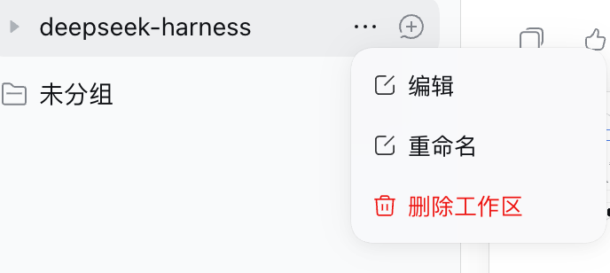
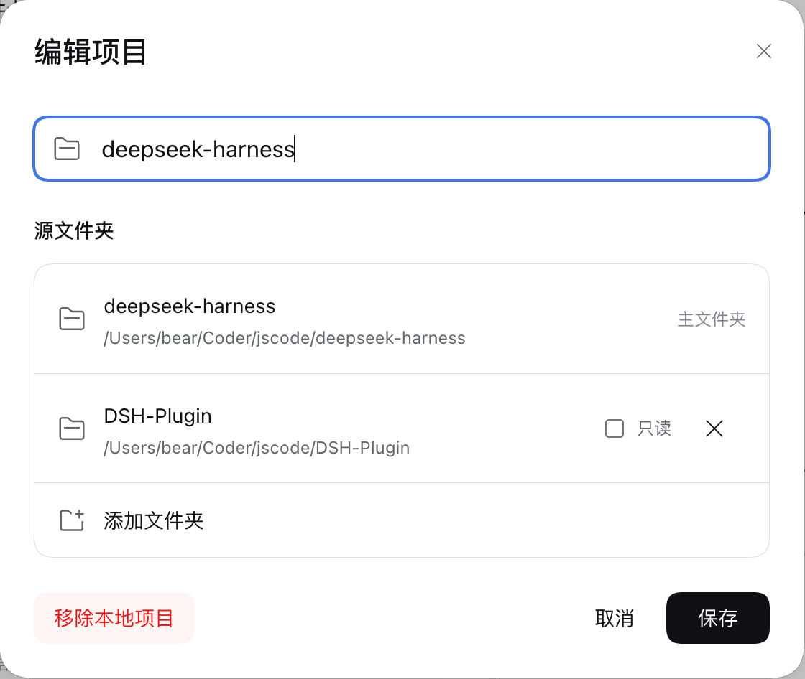

# dsh-plugin-addir

给 DeepSeek Harness 的工作区**关联额外目录** —— 像 Codex `--add-dir`、Antigravity 多根工作区那样，让智能体跨目录读写，并在工作区菜单里图形化管理。

## 它做什么

- **关联目录**：一个工作区可挂多个目录，每个带别名、描述、只读标记；按工作区根路径持久化，重启自动恢复。
- **注入上下文**：每轮把生效目录表注入模型，路径可用 `[别名]/path` 或 `别名:path` 简写。
- **只读保护**：标记 `readOnly` 的目录会被拦截 `write` / `edit`。
- **图形管理**：工作区行的「⋯」→「编辑」弹窗里增删目录、改名、勾只读；设置页负责三个全局开关。

注入到模型的内容长这样：

```markdown
# Active Workspace Directories
- [primary] `/repo/frontend` (Primary root)
- [backend] `/repo/backend` - API services
- [specs] `/repo/specs` [Read-Only]
```

## 界面

工作区行的「⋯」→「编辑」：



弹窗里改名字、添加/移除关联文件夹、勾只读；「添加文件夹」直接调系统原生目录选择器，保存后按工作区持久化：



## 安装

```sh
# 普通 profile（web / headless / 自定义）
dsh plugin --profile web add dsh-plugin-addir

# 桌面端：先启动一次应用初始化 profile，完全退出后执行，再重开应用
dsh plugin --profile desktop add dsh-plugin-addir
```

也可以在 DSH **设置 → 插件管理**里搜索 `dsh-plugin-addir` 安装。装好即启用 —— 本包自带 bundle patch，会自动把 `id: addir` 这行插入 profile，不需要手写 `insert`。

从源码安装（开发）：

```sh
git clone https://github.com/keatsyh/dsh-plugin-addir.git
cd dsh-plugin-addir
pnpm install                                   # prepare 会自动构建 lib/
dsh plugin --profile web add "link:$PWD"
```

## 配置

三个开关默认全开。在设置页里改，或在 profile 的 `cordis.patch.yml` 里覆盖：

| 字段 | 默认 | 说明 |
|---|---|---|
| `enableTools` | `true` | 暴露 `addir_*` 工具，允许智能体自己增删目录 |
| `enableContextInjection` | `true` | 每轮注入目录表 |
| `enforceReadOnly` | `true` | 拦截只读目录的写入 |
| `defaultDirectories` | `[]` | 启动即关联的目录：`path` / `alias` / `description` / `readOnly` |

```yaml
- id: addir
  config:
    enableTools: false        # 只在界面里管目录，不让智能体自作主张
    defaultDirectories:
      - path: /path/to/shared
        alias: shared
        readOnly: true
```

关联结果存于 `$DSH_HOME/storages/addir.json`，按规范化根路径分组，重启后恢复。

## 智能体工具

| 工具 | 参数 |
|---|---|
| `addir_list` | — |
| `addir_add` | `path`、`alias?`、`description?`、`readOnly?` |
| `addir_remove` | `pathOrAlias`（主目录不可移除） |

不想要这些工具就把 `enableTools` 设为 `false`，界面里仍可正常管理目录。

## 开发者 API

```ts
ctx.addir.list(sessionId)
ctx.addir.add({ path, alias, description, readOnly }, sessionId)
ctx.addir.resolvePath('[shared]/math.ts')   // 别名 → 绝对路径
ctx.addir.isUnderWorkspace(path)
ctx.addir.isReadOnly(path)
```

## 开发

```sh
pnpm test              # 单元 + 集成测试
pnpm run typecheck
pnpm run build         # 输出 lib/，含客户端产物校验
```

客户端半以经典脚本注册（`window.__ModuleLoader__.load({ id, factory })`），React 从 DSH 共享模块表解析，不能直接写 ESM `import` / `export`。改完客户端需重启 Web Host 并刷新页面。工作区菜单的「编辑」入口是 DOM 适配（`src/client/workspace-menu.ts`）：DSH 改动工作区行或原生菜单结构时需要同步调整。

## License

MIT
